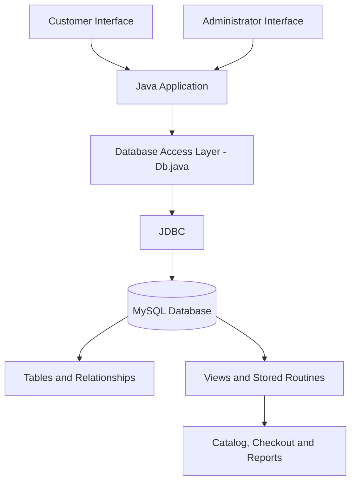

# 🛒 FreshMart — Grocery Shopping & Inventory Management System

<p align="center">
  <strong>A Java Swing and MySQL desktop application that connects grocery shopping, inventory management, order processing, and expiry-aware stock monitoring in one system.</strong>
</p>

<p align="center">
  
  
  
  
  
  
</p>

---

## 📌 Table of Contents

- [Overview](#-overview)
- [Problem Statement](#-problem-statement)
- [Project Objectives](#-project-objectives)
- [Key Features](#-key-features)
- [System Architecture](#-system-architecture)
- [Technology Stack](#-technology-stack)
- [Application Modules](#-application-modules)
- [Database Design](#-database-design)
- [Business Logic](#-business-logic)
- [Project Structure](#-project-structure)
- [Installation and Setup](#-installation-and-setup)
- [Configuration](#-configuration)
- [Testing](#-testing)
- [Security Considerations](#-security-considerations)
- [Limitations](#-limitations)
- [Future Enhancements](#-future-enhancements)
- [Learning Outcomes](#-learning-outcomes)
- [Contributing](#-contributing)
- [Author](#-author)
- [License](#-license)

---

## 🚀 Overview

**FreshMart** is a desktop-based grocery shopping and inventory management application developed using Java Swing, JDBC, and MySQL.

The project brings customer-facing shopping operations and administrative inventory workflows together in a single application.

Customers can browse products, manage their shopping carts, select delivery slots, place orders, and view order history. Administrators can manage products, receive inventory in batches, process orders, and access reports for low-stock products, near-expiry inventory, and frequently purchased product combinations.

A key design concept is **batch-level inventory management**. Instead of treating all stock of a product as one quantity, the system tracks inventory batches with their own quantities and expiry dates. This provides a foundation for better stock visibility and reduced product wastage.

### 🎯 Project at a glance

| Attribute | Details |
|---|---|
| Project name | FreshMart |
| Application type | Desktop application |
| Domain | Grocery retail and inventory management |
| Frontend | Java Swing and AWT |
| Backend logic | Java |
| Database | MySQL |
| Database connectivity | JDBC |
| Build tool | Apache Maven |
| Configured Java version | Java 17 |
| Primary user roles | Customer and Administrator |

## ❗ Problem Statement

Small grocery businesses need to manage several connected activities:

- Maintaining accurate product availability and prices.
- Tracking stock received at different times and with different expiry dates.
- Processing customer orders and monitoring their status.
- Calculating checkout totals consistently.
- Identifying products that need replenishment.
- Monitoring perishable inventory to reduce potential wastage.

When these activities are handled separately or manually, it becomes more difficult to maintain consistent information and make timely operational decisions.

**FreshMart addresses these challenges by bringing shopping, inventory, order management, and basic operational reporting into one database-backed application.**

## 🎯 Project Objectives

1. Develop a user-friendly desktop interface for grocery shopping.
2. Implement customer registration and login.
3. Provide product browsing, searching, category filtering, and cart management.
4. Maintain product information and batch-level inventory.
5. Support order placement, order-status tracking, and cancellation workflows.
6. Track inventory expiry dates and identify low-stock products.
7. Generate reports that help administrators understand inventory risks and purchasing patterns.
8. Apply Java, JDBC, SQL, and relational database concepts in a practical application.

## ✨ Key Features

### 🛍️ Customer Shopping

- Customer registration and login.
- Product catalog with category filtering.
- Search products by name.
- Product availability and stock indicators.
- Shopping cart with quantity adjustments.
- Automatic subtotal calculation.
- Delivery date and time-slot selection.
- Delivery address and payment-method selection.
- Order placement through a database stored procedure.
- Order history and order-detail views.
- Order cancellation request workflow.

### 📦 Inventory Management

- Add new grocery products.
- Edit product information and prices.
- Hide or show products in the catalog.
- Receive new inventory into separate batches.
- Track stock quantities by batch.
- Associate batches with expiry dates.
- Display available stock and upcoming expiry information.
- Identify products with five or fewer available units.

### 🧾 Order Management

- View customer orders.
- Review order details and item quantities.
- Display order totals and delivery information.
- Advance orders through the configured status workflow.
- Support cancellation through a database routine.
- Display order-status history.

The normal order progression represented in the interface is:

`PENDING → PACKED → OUT_FOR_DELIVERY → DELIVERED`

`CANCELLED` is a separate terminal state.

### 📊 Operational Reports

| Report | Purpose |
|---|---|
| Near-expiry inventory | Identify batches approaching their expiry dates and estimate potential inventory value at risk. |
| Low-stock inventory | Find products with five or fewer available units. |
| Frequently bought together | Identify product pairs that occur together in non-cancelled orders. |

The frequently-bought-together report is a basic form of descriptive market-basket analysis. It can help identify potential product bundles and cross-selling opportunities.

> **Important:** The application provides payment-method selection, not an integrated payment gateway. Likewise, the product-pair report is not a machine-learning recommendation engine.

## 🏗️ System Architecture

FreshMart uses a desktop-client architecture with a MySQL database.



### Architecture components

**1. Presentation layer**

Java Swing and AWT provide the login interface, customer shopping screens, administrator console, tables, forms, and dialogs.

**2. Application layer**

Java classes implement the customer and administrator workflows, shopping cart operations, checkout calculations, order displays, and inventory actions.

**3. Database access layer**

`Db.java` centralizes database connectivity and utility operations for executing queries, updates, and database routines.

**4. Database layer**

MySQL stores the application's persistent data and provides database objects referenced by the source code, including catalog views and order-processing routines.

The current implementation is a prototype with some UI, business logic, and database operations closely coupled. A service-and-DAO architecture is a planned improvement.

## 🧰 Technology Stack

| Technology | Purpose |
|---|---|
| Java 17 | Core application logic |
| Java Swing | Desktop user interface |
| Java AWT | UI layout and graphical components |
| MySQL | Relational data storage |
| JDBC | Java-to-MySQL connectivity |
| MySQL Connector/J | MySQL JDBC driver |
| Apache Maven | Dependency management and build automation |
| SQL | Queries, views, and stored-routine integration |
| Git and GitHub | Version control and project hosting |

## 🧩 Application Modules

### 1. Application Entry Point — `App.java`

- Launches the login interface.
- Provides reusable UI styling and form helpers.
- Supports order-detail rendering and status-history display.
- Provides common table and formatting utilities.

### 2. Customer Module — `Shop.java`

- Loads the product catalog.
- Supports product search and category filtering.
- Manages the shopping cart.
- Calculates checkout totals.
- Retrieves delivery-slot information.
- Places orders and displays order history.

### 3. Administrator Module — `Admin.java`

- Manages products and inventory batches.
- Displays and processes customer orders.
- Advances order status.
- Provides inventory and purchasing-pattern reports.

### 4. Database Utility Module — `Db.java`

- Establishes MySQL connections.
- Executes parameterized SQL operations.
- Maps database query results.
- Provides database-related utility functions.

## 🗄️ Database Design

The application references the following database entities.

| Entity | Responsibility |
|---|---|
| `customers` | Customer profiles, account credentials, and roles |
| `categories` | Product category information |
| `products` | Product details, pricing, units, and visibility |
| `product_batches` | Inventory quantities and expiry dates |
| `delivery_slots` | Delivery dates and time windows |
| `orders` | Order header, customer, delivery, payment, and status information |
| `order_items` | Products and quantities associated with orders |
| `order_status_history` | Recorded order-status changes |

### Database objects referenced by the application

| Object | Intended role |
|---|---|
| `v_catalog` | Catalog information with stock and expiry-aware pricing |
| `v_slots` | Delivery-slot information |
| `fn_price()` | Effective-price calculation |
| `place_order()` | Order creation workflow |
| `cancel_order()` | Order cancellation workflow |

The complete definitions of all these database objects are not included in the supplied project archive. Their exact database-side behavior therefore needs to be verified against the original schema.

### Why batch-level inventory matters

Consider a product with three inventory batches:

| Batch | Quantity | Expiry |
|---|---:|---|
| Batch A | 18 units | Near expiry |
| Batch B | 32 units | Later expiry |
| Batch C | 24 units | Longer shelf life |

Tracking each batch separately gives the store better visibility into stock age and expiry risk than maintaining a single product-level quantity.

The example values above are illustrative, not measured data from FreshMart.

## 💡 Business Logic Highlights

### Checkout calculation

The current Java interface uses the following fee rules:

- Delivery fee: ₹40 when the subtotal is below ₹500.
- Delivery fee: ₹0 when the subtotal is ₹500 or more.
- Packaging fee: ₹10.

For example:

| Component | Amount |
|---|---:|
| Product subtotal | ₹400 |
| Delivery fee | ₹40 |
| Packaging fee | ₹10 |
| **Illustrative total** | **₹450** |

These are the rules displayed by the current UI. A production implementation should independently validate stock, discounts, fees, and totals inside the database transaction that creates the order.

### Inventory reporting

The near-expiry and low-stock reports help administrators identify inventory that may need immediate attention.

The product-pair report counts combinations appearing in non-cancelled orders. A future version could extend this analysis using support, confidence, and lift to evaluate the strength of product associations.

## 📁 Project Structure

```text
freshmart-java/
│
├── pom.xml
│
├── src/
│   └── main/
│       └── java/
│           ├── App.java
│           ├── Shop.java
│           ├── Admin.java
│           └── Db.java
│
├── upgrade.sql
│
└── target/
    └── Compiled classes and Maven build artifacts
```

**Note:** The `target/` directory contains generated build artifacts. For a clean GitHub repository, generated files should generally be excluded from version control.

The project archive contains an upgrade script, not a complete database initialization package. Obtain the original schema and stored-routine definitions before claiming that a fresh database can be initialized using `upgrade.sql` alone.

## ⚙️ Installation and Setup

### Prerequisites

Install the following software:

- JDK 17 or a compatible newer JDK.
- Apache Maven.
- MySQL Server.
- Git.
- An IDE such as IntelliJ IDEA, Eclipse, or VS Code with Java support.

### Step 1: Clone the repository

Replace `YOUR_USERNAME` with your GitHub username after publishing the repository.

```bash
git clone https://github.com/YOUR_USERNAME/freshmart-java.git
cd freshmart-java
```

### Step 2: Prepare the database

Create the `grocery` database and initialize its tables, constraints, required views, functions, stored procedures, and sample data using the complete database setup scripts.

The current `upgrade.sql` assumes an existing database schema. It does not, by itself, establish every database object required by the application.

### Step 3: Configure database access

The application reads database configuration from these environment variables:

```text
DB_URL
DB_USER
DB_PASSWORD
```

For a local MySQL installation, the URL typically follows this format:

```text
jdbc:mysql://localhost:3306/grocery
```

Use a dedicated MySQL application account with appropriate privileges. Do not use a privileged production account or commit credentials to GitHub.

### Step 4: Build the project

```bash
mvn clean compile
```

### Step 5: Launch the application

```bash
mvn exec:java
```

The Maven execution configuration is intended to launch the `App` class.

> **Setup status:** The Java source files have been compiled with `javac` in an inspection environment. A complete end-to-end run against a freshly initialized MySQL database has not been verified. Successful execution requires the correct schema, database routines, driver, and connection settings.

## 🔐 Configuration and Security

Before using the project beyond a controlled demonstration, address these items:

- Replace simple SHA-256 password hashing with a password-specific algorithm such as Argon2id or bcrypt.
- Remove hard-coded demo credentials from the login interface.
- Use a dedicated database user with least-privilege permissions.
- Keep database passwords outside source control.
- Validate prices, quantities, addresses, and other user inputs.
- Enforce order ownership and cancellation eligibility in database routines.
- Use transactions and appropriate locking to prevent overselling.
- Recalculate order totals using trusted database values.
- Avoid exposing raw database exception details to end users.

## 🧪 Testing

The following tests are recommended before a release:

- Authentication and registration validation.
- Product creation and editing.
- Inventory batch creation and expiry handling.
- Shopping cart quantity validation.
- Delivery-fee boundary conditions.
- Delivery-slot availability.
- Order creation and stock deduction.
- Order cancellation and stock restoration.
- Unauthorized order-access attempts.
- Concurrent purchases of limited stock.
- Report accuracy and database failure handling.

Automated unit and integration tests are planned improvements. These tests should be added before describing the application as production-ready.

## ⚠️ Current Limitations

FreshMart is an academic project and should not yet be considered production-ready.

1. The complete original database schema and all stored-routine definitions are not present in the supplied archive.
2. Password storage and demo credentials require security improvements.
3. Some business logic is embedded directly in Swing UI classes.
4. Database operations can block the UI while queries execute.
5. The shopping cart is maintained in application memory.
6. Payment-method selection is not connected to a payment gateway.
7. Order ownership, inventory concurrency, and cancellation rules require database-level verification.
8. Automated test coverage and a reproducible database setup need to be added.

These limitations define the next engineering tasks rather than diminishing the project's value as a learning and development project.

## 🛣️ Future Enhancements

### Phase 1 — Reliability and security

- Complete the database initialization scripts.
- Improve password storage and credential management.
- Enforce transaction-safe inventory operations.
- Add automated tests for checkout and order cancellation.

### Phase 2 — Architecture and maintainability

- Separate presentation, service, DAO, and model layers.
- Move database operations off the Swing event-dispatch thread.
- Introduce structured logging and clearer exception handling.
- Add application configuration profiles.

### Phase 3 — Analytics and business intelligence

- Add sales and revenue dashboards.
- Analyze best-selling products and repeat purchases.
- Track inventory turnover and expiry-related losses.
- Export reports to CSV and Excel.

### Phase 4 — Data science and optimization

- Forecast demand at product level.
- Recommend replenishment quantities.
- Predict potential expiry-related waste.
- Extend product-pair analysis with association-rule metrics.
- Evaluate analytical models against simple baselines.

### Phase 5 — Optional web application

- Expose business functionality through a Spring Boot REST API.
- Develop a browser-based frontend.
- Add secure authentication and authorization.
- Integrate a payment gateway only when appropriate testing and security requirements are met.

## 📚 Learning Outcomes

This project provides practical experience with:

- Object-oriented programming in Java.
- Desktop UI development using Swing and AWT.
- Relational database design and SQL.
- JDBC connectivity and parameterized queries.
- Database-backed application workflows.
- Inventory and order-management logic.
- Transaction handling.
- Basic operational reporting.
- Software architecture and security considerations.
- Git and GitHub project documentation.

It also provides a foundation for extending a conventional business application with analytics and data science.

## 🤝 Contributing

Contributions and suggestions are welcome.

1. Fork the repository.
2. Create a feature branch.
3. Implement and test your changes.
4. Commit with a descriptive message.
5. Open a pull request describing the change.

Please avoid committing database passwords, real customer information, or other sensitive data.

## 👨‍💻 Author

**Sujal Salunke**

GitHub: [YOUR_GITHUB_USERNAME](https://github.com/YOUR_GITHUB_USERNAME)

LinkedIn: [YOUR_LINKEDIN_PROFILE](https://www.linkedin.com/)

*Replace the placeholder links with your actual public profiles before publishing.*

## 📄 License

No license has been established for this repository yet.

If you want others to use, modify, and distribute the project, choose an appropriate open-source license and add its corresponding `LICENSE` file. Only publish code and assets that you have the right to distribute.

---

<p align="center">
  <strong>FreshMart — Connecting Grocery Shopping with Smarter Inventory Management.</strong>
</p>

<p align="center">
  Built with Java, JDBC, and MySQL.
</p>
